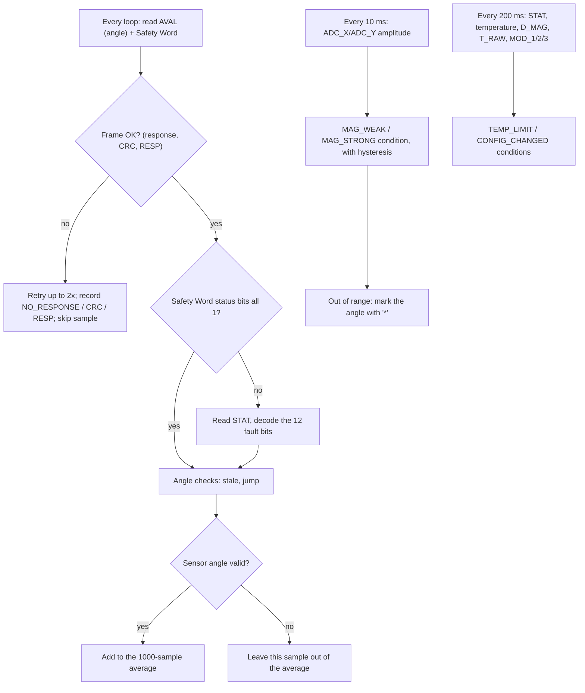

# TLE5012B Error Codes Guide (XIAO ESP32C3)

How the error-code sketch works, how to build and flash it, what every error code means, how to fix each one, and how to process these codes in your own firmware.

Sketch: `ARDUINO CODES/TLE5012B_ErrorCodes_C3/`

| File | Contents |
|---|---|
| `TLE5012B_ErrorCodes_C3.ino` | Settings, checks, print modes, serial commands, self-test |
| `tle5012b_errors.h` | The 25 error codes: bit mask, name, layer, meaning, action, source |
| `tle5012b_ssc.h` | Sensor bus (SSC) reads, CRC, Safety Word and STAT decoding |

Source tags used throughout (same as in the code):

| Tag | Source |
|---|---|
| [DS] | Infineon TLE5012B Data Sheet Rev 2.1 (`DOCS, LOGS and PICS/Infineon_TLE5012B_Datasheet.pdf`) |
| [LIB] | Infineon TLE5012B Arduino library v3.1.0, https://github.com/Infineon/TLE5012-Magnetic-Angle-Sensor |
| [PLAN] | `GMR_Error_Codes/GMR_TLE5012B_Error_Diagnostics_and_Test_Plan.md` |
| [HEC] | `GMR_Error_Codes/(Description) Hallever Error Codes.pdf` |
| [XIAO] | Seeed Studio XIAO ESP32C3 pinout, https://wiki.seeedstudio.com/XIAO_ESP32C3_Getting_Started/ |
| ESTIMATE | No documented value exists; a reasonable default that you can tune |

---

## 1. Quick start

1. Wire the sensor (section 2).
2. Open `TLE5012B_ErrorCodes_C3.ino` in the Arduino IDE. The two `.h` files open as tabs.
3. Select **Tools > Board > esp32 > XIAO_ESP32C3** and **Tools > USB CDC On Boot > Enabled**.
4. Upload, then open the Serial Monitor at **115200 baud**.
5. Check that the boot self-test ends with `ALL PASS`.
6. Watch the line output. `ERR none` means no error in that print interval.

---

## 2. Hardware

| TLE5012B | XIAO ESP32C3 | GPIO |
|---|---|---|
| VDD | 3V3 | |
| GND | GND | |
| CSQ | D2 | GPIO4 |
| SCK | D5 | GPIO7 |
| DATA, through 470 Ω | D4 (MOSI) | GPIO6 |
| DATA, through 470 Ω | D10 (MISO) | GPIO10 |

The pins are the same as `GMR_SMA_C3.ino`; GPIO numbers are from [XIAO].

The sensor has a single bidirectional DATA line. The ESP32 sends the 16-bit command word on MOSI, then releases MOSI (sets it to input) so the sensor can drive DATA while the ESP32 reads on MISO. The 470 Ω series resistors limit current if both sides drive the line at the same moment [DS 3.7].

If releasing MOSI doesn't work on your board (constant `NO_RESPONSE` or `CRC`), add this line above the `#include`s in the `.ino`:

```cpp
#define TLE_RELEASE_MOSI_DURING_READ 0
```

MOSI then stays attached and clocks out `0xFFFF` while the sensor answers; the resistors protect the line.

Bus settings: SPI mode 1, MSB first, 1 MHz. The sensor allows up to 8 Mbit/s [DS Table 15]. The minimum timings tCSs 105 ns, twr_delay 130 ns and tCSoff 600 ns [DS Table 15] are met with 1 µs delays.

---

## 3. Building and flashing

### Arduino IDE

| Setting | Value |
|---|---|
| Board package | esp32 by Espressif Systems (tested with 3.3.8) |
| Board | XIAO_ESP32C3 |
| USB CDC On Boot | Enabled (otherwise nothing appears on the USB serial port) |
| Serial Monitor | 115200 baud, any line ending |

If the upload fails, hold BOOT, tap RESET, release BOOT, then upload again.

### Command line (optional)

The Arduino IDE ships `arduino-cli` inside its install folder:

```bash
cd "ARDUINO CODES/TLE5012B_ErrorCodes_C3"
arduino-cli compile --fqbn esp32:esp32:XIAO_ESP32C3:CDCOnBoot=cdc .
arduino-cli upload  --fqbn esp32:esp32:XIAO_ESP32C3:CDCOnBoot=cdc -p /dev/ttyACM0 .
```

Current build size: about 310 kB flash (23%) and 21 kB RAM (6%).

---

## 4. Using the serial output

### Commands

Type one character and press Enter.

| Key | Action |
|---|---|
| `1` | Line mode, 10 prints per second (default) |
| `2` | Dashboard mode, 1 print per second |
| `3` | Table mode, 5 prints per second |
| `d` | Register report with every field decoded |
| `e` | Print the full error-code list (meaning, action, source) |
| `t` | Rerun the decoder self-test |
| `a` | Interface-access test (reads MOD_2 with a wrong lock) |
| `r` | Reset error counters |
| `h` | Help |

### Reading a line (mode 1)

```
t=   12.345 s | RAW 123.456 deg (11234) | FILT 123.457 deg | MAG  9480 | CRC OK   | RESP OK   | SW 0xFE89 | ERR none
```

| Field | Meaning |
|---|---|
| `t` | Seconds since boot |
| `RAW` | Latest angle in degrees, with the raw 15-bit count (0–32767) in brackets |
| `FILT` | 1000-sample average of the angle, same method as `GMR_SMA_C3.ino`. Samples are unwrapped first, so a window that crosses 0°/360° is not pulled toward 180° |
| `MAG` | Magnet amplitude `sqrt(ADC_X² + ADC_Y²)` in digits; 6000–15781 is in range [DS Table 10] |
| `CRC` / `RESP` | Frame checks for the print interval |
| `SW` | Last Safety Word received |
| `ERR` | Every event seen since the previous print, plus every condition still active |

A `*` after an angle means it is **not trusted** because the magnet is out of range. The average keeps running, so `FILT` stays smooth; do not use the number while the `*` is there.

`---` means no valid value is available yet, or the latest read failed.

### Events and conditions

There are two kinds of error codes:

- **Events** happen at one moment: a bad CRC, a reset, an angle jump. They are shown on the next print, then cleared. The count goes up once per occurrence.
- **Conditions** are states: `MAG_WEAK`, `MAG_STRONG`, `TEMP_LIMIT`, `CONFIG_CHANGED`. They are shown on **every** print for as long as they last. The count goes up once each time the condition starts.

---

## 5. How detection works



### The four layers [PLAN 1]

1. **Frame**: checked by the ESP32 on every transfer. If the frame is bad, nothing else in it can be trusted, so the Safety Word status bits are not decoded.
2. **Safety Word**: the sensor appends this 16-bit word to every read [DS Table 18]:

   | Bits | Content |
   |---|---|
   | 15 | Reset / watchdog. 0 = occurred (active-low) |
   | 14 | System error. 0 = occurred |
   | 13 | Interface access error. 0 = occurred |
   | 12 | Angle valid. 0 = invalid |
   | 11:8 | RESP: `1110` for slave 0 |
   | 7:0 | CRC-8 (J1850: polynomial 0x1D, seed 0xFF, result inverted) over the command word plus the data words [DS 4.4.1.2] [LIB] |

   The status bits stay low until STAT is read [DS Table 18, footnote 1].
3. **STAT register**: 12 detailed fault flags. Reading STAT clears them.
4. **Application**: checks the firmware infers from other registers (magnet amplitude, temperature, configuration, angle behaviour).

### Recovery policy used [PLAN Phase D]

| Situation | What the sketch does |
|---|---|
| CRC / RESP / no response | Retry the read up to 2 times; skip the sample if all attempts fail |
| Invalid angle | Leave it out of the average; keep reporting |
| Magnet out of range | Keep reporting and keep averaging; the `*` marks the line |
| Reset or configuration change | Report it (this sketch never writes to the sensor, so there is nothing to re-apply) |
| Repeated watchdog / ROM / fuse failures | Report them; the action text says to escalate |

---

## 6. Error code reference

Each code is one bit in a `uint32_t`, so several can be active at once. `e` on the serial port prints this list from the firmware itself.

| Bit | Code | Layer | Kind |
|---|---|---|---|
| 0 | `NO_RESPONSE` | Frame | Event |
| 1 | `CRC` | Frame | Event |
| 2 | `RESP` | Frame | Event |
| 3 | `SW_RESET` | Safety Word | Event |
| 4 | `SW_SYSTEM` | Safety Word | Event |
| 5 | `SW_ACCESS` | Safety Word | Event |
| 6 | `SW_ANGLE_INVALID` | Safety Word | Event |
| 7 | `S_RST` | STAT | Event |
| 8 | `S_WD` | STAT | Event |
| 9 | `S_VR` | STAT | Event |
| 10 | `S_FUSE` | STAT | Event |
| 11 | `S_DSPU` | STAT | Event |
| 12 | `S_OV` | STAT | Event |
| 13 | `S_XYOL` | STAT | Event |
| 14 | `S_MAGOL` | STAT | Event |
| 15 | `S_ADCT` | STAT | Event |
| 16 | `S_ROM` | STAT | Event |
| 17 | `NO_GMR_XY` | STAT | Event |
| 18 | `NO_GMR_A` | STAT | Event |
| 19 | `MAG_WEAK` | Application | Condition |
| 20 | `MAG_STRONG` | Application | Condition |
| 21 | `TEMP_LIMIT` | Application | Condition |
| 22 | `CONFIG_CHANGED` | Application | Condition |
| 23 | `STALE_ANGLE` | Application | Event |
| 24 | `ANGLE_JUMP` | Application | Event |

STAT bits 8 (reserved), 14:13 (S_NR, the slave number) and 15 (RD_ST, information only) are not faults and have no code [LIB tle5012b_reg.cpp].

### Frame layer

**`NO_RESPONSE`**: the data words and the Safety Word read all `0x0000` or all `0xFFFF` [PLAN 3]. This is a heuristic: a dead line reads as all-0 or all-1.
- Likely causes: sensor not powered, CS not connected, DATA line open or shorted, wrong pins, MOSI release not working.
- Fixes:
  1. Check 3V3 and GND at the sensor.
  2. Check the CS, SCK and DATA wiring and both 470 Ω resistors.
  3. Confirm the pin defines in the `.ino`.
  4. Try `TLE_RELEASE_MOSI_DURING_READ 0`.

**`CRC`**: the CRC in the Safety Word doesn't match the command and data [DS 4.4.1.2].
- Likely causes: noise on SCK/DATA, long or unshielded wires, a loose connection, the SPI clock too fast for the wiring, a bad ground.
- Fixes:
  1. Shorten the wires and twist DATA with GND.
  2. Lower `SSC_CLOCK_HZ` (for example 500000).
  3. Improve the ground connection.
- An occasional CRC that the retry clears is a noise event. Constant CRC errors are a wiring or timing problem.

**`RESP`**: the RESP nibble isn't `1110` [DS Table 18].
- Likely causes: another device on the bus, the sensor configured with a different slave number, or bit errors on DATA.
- Fixes: check that only this sensor is on CS D2, and check the DATA wiring. If it appears together with `CRC`, treat it as a noise problem.

### Safety Word layer

These are summary bits. When one appears, the sketch immediately reads STAT, and the detailed STAT code appears on the same print.

**`SW_RESET`**: a chip reset or watchdog overflow happened since the last STAT read [DS Table 18 bit 15].
- Expected once right after power-up. The sketch reads and clears it at boot.
- Mid-run, it means the sensor reset: a supply dip or brown-out, or a watchdog fault. See `S_RST`, `S_WD` and `S_VR`.

**`SW_SYSTEM`**: system error summary [DS Table 18 bit 14]. It covers S_VR, S_DSPU, S_OV, S_XYOL, S_MAGOL, S_FUSE, S_ROM and S_ADCT; look at the STAT code shown with it.

**`SW_ACCESS`**: interface access error [DS Table 18 bit 13]. The command used a wrong address or a wrong lock value [DS Table 17].
- The sketch only sends known-good commands, so this should only appear during the `a` test.
- If it appears in normal running, a command word was corrupted on the line. Treat it like `CRC`.

**`SW_ANGLE_INVALID`**: the sensor marks the angle as invalid [DS Table 18 bit 12]. This goes with `NO_GMR_A` / `NO_GMR_XY`.
- The angle is not used.
- Likely cause: magnet missing or far out of range, or the sensor still starting up.

### STAT layer

Meanings are from [LIB tle5012b_reg.cpp] and [HEC].

**`S_RST`**: reset event recorded.
- Expected after power-up.
- Mid-run, check the supply for dips (motor start, shared supply), the decoupling capacitor at the sensor, and the ground.

**`S_WD`**: DSP watchdog expired. The sensor's internal processing stopped running correctly.
- Fix: power-cycle the sensor. If it repeats, the sensor is faulty and should be replaced.

**`S_VR`**: voltage regulator, VDD or GND fault (over-voltage, under-voltage, VDD-off, GND-off) [DS 4.6] [HEC].
- Fixes:
  1. Measure VDD at the sensor pins; it must be 3.0–5.5 V [DS Table 4].
  2. Check the GND wire and the decoupling capacitor.
  3. Avoid sharing a supply line with motors.

**`S_FUSE`**: integrity check of the internal configuration fuses failed.
- Fix: power-cycle. If it repeats, the sensor is faulty.

**`S_DSPU`**: the self-test of the internal angle processing unit failed, or is still running.
- A single occurrence at startup can be normal. If it persists, the sensor is faulty.

**`S_OV`**: internal DSP overflow.
- Usually caused by an extreme magnetic field. Check the magnet distance first; if it persists with a correct magnet, the sensor is faulty.

**`S_XYOL`**: raw X/Y values are outside the allowed range.
- Fix: the magnet is too close, too far or off-axis. Adjust the air gap and centre the magnet over the sensor.

**`S_MAGOL`**: the magnetic vector magnitude is outside the sensor's limits.
- Fix: correct the magnet distance. The specified field is 30–50 mT [DS Table 4].
- The datasheet doesn't give the sensor's internal limits as numbers. In practice, `MAG_WEAK` / `MAG_STRONG` can warn before this flag appears.

**`S_ADCT`**: the ADC test-vector check failed. It stays set until the next chip reset [DS 4.4.2].
- Fix: power-cycle the sensor. If it comes back, the sensor is faulty.

**`S_ROM`**: the internal ROM check failed, or is still running.
- Normal only briefly at startup. If it persists, the sensor is faulty.

**`NO_GMR_XY`**: no valid X/Y GMR values. **`NO_GMR_A`**: no valid GMR angle.
- The angle is rejected.
- Likely cause: no magnet, the magnet far out of range, or startup.
- Fix: place and centre the magnet.

### Application layer

**`MAG_WEAK`** (condition): the X/Y amplitude is below 6000 digits, the minimum amplitude at ambient temperature [DS Table 10]. It clears again above 6000 + 200 digits (hysteresis, ESTIMATE). The angle is shown with `*`.
- Likely causes: magnet too far away, magnet too weak, magnet off-centre.
- Fix: reduce the air gap, centre the magnet, or use a stronger magnet.

**`MAG_STRONG`** (condition): the X/Y amplitude is above 15781 digits, the maximum at ambient [DS Table 10]. It clears below 15781 − 200 digits. The angle is shown with `*`.
- Fix: increase the air gap.

**`TEMP_LIMIT`** (condition): the sensor temperature is outside −40 to 125 °C.
- The lower limit is from [DS Table 4]. The upper limit is an ESTIMATE that leaves margin below the 150 °C junction maximum [DS Table 4].
- The temperature is `(TEMPR + 152) / 2.776`, where TEMPR is the signed 9-bit value in FSYNC [LIB getTemperature]. The absolute accuracy of this reading is not specified in the datasheet; use it as an indication.
- Fix: check the thermal environment (motor heat, enclosure).

**`CONFIG_CHANGED`** (condition): MOD_1, MOD_2 or MOD_3 differ from the values read at boot [PLAN 5]. Only defined fields are compared (masks `0xC017`, `0x7FFF`, `0xFFFF` from [LIB]).
- Likely causes: the sensor reset and reloaded different defaults, or something else wrote to it. This sketch never writes to the sensor.
- Fix: power-cycle the system. In your own firmware, re-apply your configuration after a reset (see section 7).

**`STALE_ANGLE`** (event): AVAL's "new value" bit (RD_AV, bit 15) hasn't been set for more than 10 ms.
- The sensor updates the angle every 42.7–170.6 µs [DS Table 12], so 10 ms (ESTIMATE) means its processing has stopped.
- A shaft that isn't moving is **not** stale: the sensor still produces new values.
- Fix: check `S_DSPU` / `S_WD`, then power-cycle.
- If it fires constantly on a sensor that is otherwise working, RD_AV doesn't behave as expected on your part. Set `STALE_ANGLE_MS` very high to disable the check, and report it.

**`ANGLE_JUMP`** (event): the angle changed by more than 20° between two valid samples less than 10 ms apart. Both limits are ESTIMATE, intended for a hand-turned or slow shaft.
- Likely causes: the magnet moved or slipped, a mechanical shock, a stray magnetic field, or a real fast move.
- Fix: if your shaft legitimately turns faster than 2000 °/s, raise `JUMP_MAX_DEG`.

---

## 7. Writing your own code with these error codes

`tle5012b_errors.h` and `tle5012b_ssc.h` are self-contained. Copy both into your sketch folder.

### Minimal example

```cpp
#include "tle5012b_errors.h"
#include "tle5012b_ssc.h"

void setup()
{
    Serial.begin(115200);
    delay(10);                                    // tPon <= 7 ms [DS Table 4]
    sscBegin(D5, D10, D4, D2, 1000000);           // SCK, MISO, MOSI, CS, Hz
    sscRead(CMD_READ_STAT);                       // clear the power-up reset flags
}

void loop()
{
    SscFrame f = sscRead(CMD_READ_AVAL);
    uint32_t errors = f.errors;

    // Only trust the Safety Word bits if the frame itself is good
    if (f.frameOk() && (errors & ERR_SAFETY_MASK)) {
        SscFrame s = sscRead(CMD_READ_STAT);      // also clears the latched bits
        if (s.frameOk()) errors |= decodeStat(s.data[0]);
    }

    bool angleOk = f.frameOk() &&
                   !(errors & (ERR_SW_ANGLE_INVALID | ERR_NO_GMR_A | ERR_NO_GMR_XY));

    if (angleOk) {
        float deg = avalToDegrees(f.data[0]);
        // use deg
    }

    if (errors) {
        Serial.print("errors: ");
        printErrorNames(Serial, errors);           // "CRC, S_VR"
        Serial.println();
    }
    delay(1);
}
```

### Decision helper

Classify the mask into the actions from [PLAN Phase D]:

```cpp
enum Action { ACT_OK, ACT_RETRY, ACT_REJECT, ACT_REINIT, ACT_FAULT };

Action classify(uint32_t e)
{
    if (e & (ERR_S_WD | ERR_S_FUSE | ERR_S_ROM | ERR_S_ADCT)) return ACT_FAULT;   // escalate if repeated
    if (e & (ERR_S_RST | ERR_SW_RESET | ERR_CONFIG_CHANGED))  return ACT_REINIT;  // re-apply config
    if (e & ERR_FRAME_MASK)                                    return ACT_RETRY;   // read again
    if (e & (ERR_SW_ANGLE_INVALID | ERR_NO_GMR_A | ERR_NO_GMR_XY |
             ERR_MAG_MASK | ERR_S_XYOL | ERR_S_MAGOL | ERR_ANGLE_JUMP))
                                                               return ACT_REJECT;  // drop this angle
    return ACT_OK;
}
```

Recommended handling:

| Action | What to do |
|---|---|
| `ACT_RETRY` | Read again, up to 2–3 times. If every attempt fails, treat the sample as missing and hold the last good angle. |
| `ACT_REJECT` | Don't use this angle. Hold the last good value or stop the motor, depending on your safety needs. |
| `ACT_REINIT` | Read STAT to clear the flags, re-apply any configuration you write, and re-take your MOD baseline. |
| `ACT_FAULT` | Count occurrences. One after a power-cycle can be tolerated; repeated ones mean replace the sensor. Stop the motor. |

### Rules that matter

1. **Check the frame first.** Never decode Safety Word bits or STAT bits from a frame that failed CRC/RESP/response.
2. **Reading STAT clears the latched flags.** Save the raw STAT value before you decode it, and read STAT only after a Safety Word flag or on a schedule.
3. **Treat states as states.** A magnet check that runs every 200 ms, combined with a list that is cleared on every print, makes the error look like it comes and goes. Keep a condition mask that stays set until the value recovers (see section 8).
4. **Use hysteresis** on any analog limit, otherwise a value near the limit flickers.
5. **Average the angle in degrees**, and unwrap each sample (add the shortest step from the previous one) before it goes into the sum. A sin/cos average cancels out once the window covers a wide move, and the result jumps. A plain average of the raw 0–360 numbers is pulled toward 180° when the window crosses 0°.
6. **Expect `S_RST` / `SW_RESET` once at power-up** and clear them with a STAT read before you start monitoring.

### Decoding a mask on the PC

The mask is a plain bit field. Python example:

```python
NAMES = ["NO_RESPONSE", "CRC", "RESP", "SW_RESET", "SW_SYSTEM", "SW_ACCESS",
         "SW_ANGLE_INVALID", "S_RST", "S_WD", "S_VR", "S_FUSE", "S_DSPU", "S_OV",
         "S_XYOL", "S_MAGOL", "S_ADCT", "S_ROM", "NO_GMR_XY", "NO_GMR_A",
         "MAG_WEAK", "MAG_STRONG", "TEMP_LIMIT", "CONFIG_CHANGED",
         "STALE_ANGLE", "ANGLE_JUMP"]

def decode(mask: int) -> list[str]:
    return [n for i, n in enumerate(NAMES) if mask >> i & 1] or ["none"]

print(decode(0x00080002))   # ['CRC', 'MAG_WEAK']
```

The bit order must match the `ErrorBit` enum in `tle5012b_errors.h`.

### Adding a new error code

1. Add an `EB_...` entry to the `ErrorBit` enum, before `ERR_CODE_COUNT`.
2. Add the matching `ERR_...` constant.
3. Add an entry at the same position in `ERROR_TABLE` (name, layer, meaning, action, source).
4. If it is a state, add it to `ERR_CONDITION_MASK` and set it with `setConditions()`.
5. Up to 32 codes fit in the `uint32_t`.

---

## 8. Fix: magnet moved away slowly showed `ERR none`

**Symptom:** moving the magnet slowly away from the sensor, out of its range, still printed `ERR none` on some or all lines.

**Cause:**
- The magnet check ran only on the 200 ms slow poll. Line mode prints every 100 ms and clears its error list after each print, so every second line showed `none` even while the magnet was out of range.
- A fast move away also triggers `ANGLE_JUMP`, which is why the problem only appeared on slow moves.
- The sensor itself kept reporting a "valid" angle with no STAT flag, so its internal limits had not been reached yet. The datasheet doesn't give those limits as numbers. So no sensor flag covered the gap either.

**Fix:**
1. The magnet check now runs every **10 ms** on its own schedule.
2. `MAG_WEAK`, `MAG_STRONG`, `TEMP_LIMIT` and `CONFIG_CHANGED` are now **conditions**. They are shown on every print until the value is back inside its limit.
3. **Hysteresis** of 200 digits stops a noisy amplitude near the limit from flickering.
4. While the magnet is out of range, the angle is marked `*`. The average keeps running, so `FILT` does not freeze.
5. Line mode now shows the `MAG` amplitude, so you can see the margin directly.

**If you still see `ERR none` while the angle is clearly wrong:** your setup loses angle accuracy before the amplitude drops below 6000 digits. Calibrate the threshold:
1. Use line mode and move the magnet away slowly.
2. Note the `MAG` value at which the angle stops following the shaft.
3. Set `MAG_MIN_DIGITS` in the `.ino` a margin above that value, for example 10–20% higher.
4. This turns the limit into a measured value for your magnet and air gap. Note it as such in the code.

---

## 9. Threshold and timing settings

All of these are named constants at the top of the `.ino`.

| Constant | Value | Status | Basis |
|---|---|---|---|
| `SSC_CLOCK_HZ` | 1 MHz | Sourced | Maximum 8 Mbit/s [DS Table 15] |
| `FRAME_RETRIES` | 2 | Policy | Retry on frame errors [PLAN Phase D] |
| `SMA_WINDOW` | 1000 | User choice | Matches the existing SMA sketches |
| `MAG_MIN_DIGITS` | 6000 | Sourced | Minimum X/Y amplitude at ambient [DS Table 10] |
| `MAG_MAX_DIGITS` | 15781 | Sourced | Maximum X/Y amplitude at ambient [DS Table 10] |
| `MAG_HYST_DIGITS` | 200 | ESTIMATE | About 2% of the 9500 typical amplitude |
| `MAG_POLL_MS` | 10 | ESTIMATE | Fast enough for every print; one read takes about 60 µs |
| `TEMP_MIN_C` | −40 °C | Sourced | Junction range [DS Table 4] |
| `TEMP_MAX_C` | 125 °C | ESTIMATE | Margin below the 150 °C junction maximum [DS Table 4] |
| `STALE_ANGLE_MS` | 10 | ESTIMATE | About 60x the slowest update period of 170.6 µs [DS Table 12] |
| `JUMP_MAX_DEG` / `JUMP_WINDOW_MS` | 20° / 10 ms | ESTIMATE | Hand-turned or slow shaft |
| `POWER_ON_WAIT_MS` | 10 | Sourced | tPon maximum 7 ms [DS Table 4] |
| `SLOW_POLL_MS` | 200 | Design | STAT, temperature and configuration change slowly |

The magnet limits are specified at ambient temperature. The amplitude changes with temperature, so if you run hot or cold, recheck them.

---

## 10. Decoder self-test

It runs at boot and on `t`. It needs no hardware fault, because it feeds known values into the decoders and checks the result.

| Test | Expected |
|---|---|
| CRC of command `0x5081` + data `0x0804` [PLAN Phase B] | `0x89` |
| Safety Word `0xFE89` | none |
| `0x0000` with data `0x0000`; `0xFFFF` with data `0xFFFF` | `NO_RESPONSE` |
| `0xFE88` | `CRC` |
| `0xFF89` | `RESP` |
| `0x7E89` / `0xBE89` / `0xDE89` / `0xEE89` | `SW_RESET` / `SW_SYSTEM` / `SW_ACCESS` / `SW_ANGLE_INVALID` |
| Each of the 16 STAT bits alone | Its own code; bits 8, 13, 14, 15 give none |
| Angle wrap 0.1° − 359.9° | +0.2° |
| AVAL `0x4000` | 180.000° |

`ALL PASS` proves the decoding logic is correct. It does not test the sensor or wiring; the live checks do that.

---

## 11. Hardware tests you can do safely

| Test | How | Expected codes |
|---|---|---|
| Magnet weak | Move the magnet slowly away | `MAG_WEAK` on every line and `*` on angles; possibly `S_XYOL` / `S_MAGOL` / `NO_GMR_*` further away |
| Magnet strong | Bring a strong magnet very close | `MAG_STRONG`, possibly `S_XYOL` / `S_MAGOL` |
| Magnet removed quickly | Pull it away fast | `ANGLE_JUMP` plus the magnet codes |
| Wiring fault | Disconnect DATA briefly (power off first if unsure) | `NO_RESPONSE` or `CRC`, retries counted |
| Reset | Power-cycle the sensor alone, with the ESP32 still running | `SW_RESET`, `S_RST`, possibly `CONFIG_CHANGED` |
| Access error | Press `a` | `SW_ACCESS` if the sensor checks the lock on reads (result printed) |

Faults inside the sensor (`S_WD`, `S_FUSE`, `S_ROM`, `S_ADCT`, `S_DSPU`, `S_OV`) can't be created safely from outside. The self-test covers their decoding.

---

## 12. Troubleshooting

| What you see | Check |
|---|---|
| Nothing on Serial Monitor | USB CDC On Boot enabled; 115200 baud; press RESET |
| `NO_RESPONSE` on every line | Power, CS wiring, pin defines; try `TLE_RELEASE_MOSI_DURING_READ 0` |
| `CRC` constantly | Wire length, ground, lower `SSC_CLOCK_HZ` |
| `STALE_ANGLE` constantly while the angle updates | RD_AV behaviour; disable by raising `STALE_ANGLE_MS` |
| `MAG_WEAK` with a magnet in place | Air gap too large, magnet off-centre, magnet too weak |
| `ANGLE_JUMP` during normal fast motion | Raise `JUMP_MAX_DEG` |
| `CONFIG_CHANGED` after boot | Sensor reset or was written to; power-cycle |
| Self-test `FAIL` | The decoder code was modified; compare with the original headers |

---

## 13. Points still to verify on hardware

- Releasing MOSI during reads on the ESP32-C3 core (fallback: `TLE_RELEASE_MOSI_DURING_READ 0`).
- RD_AV behaving as "new value since last read" (affects `STALE_ANGLE`).
- Whether the sensor raises `SW_ACCESS` for a read with the wrong lock (the `a` test reports it).
- The `MAG` amplitude at which your own magnet and air gap stop giving a correct angle (section 8).
